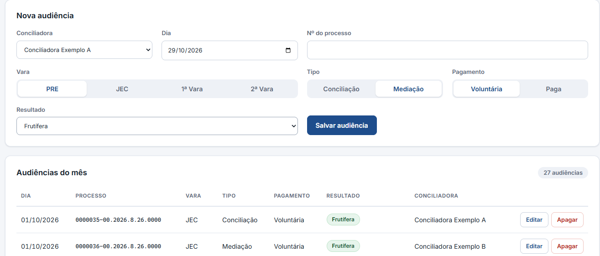
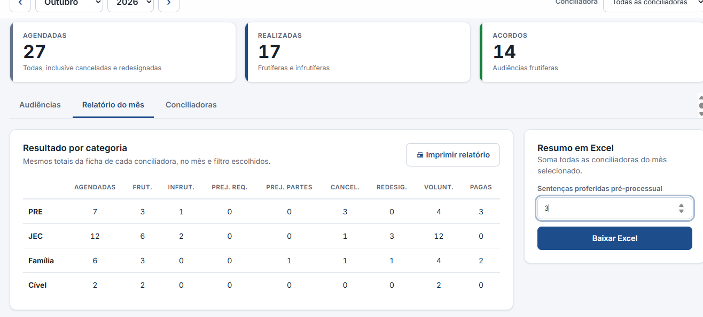
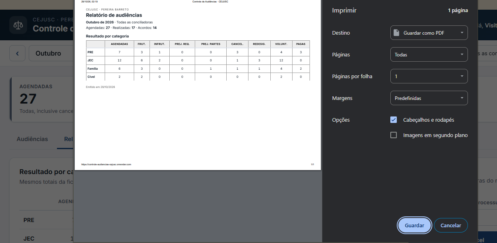

# Controle de Audiências — CEJUSC

Sistema web que substitui o preenchimento manual de fichas mensais por conciliadora e a consolidação em planilha Excel. Registra as audiências, calcula os totais do mês por categoria e gera a planilha de resumo já preenchida.

## Como surgiu

Durante o meu estágio no CEJUSC do Fórum de Pereira Barreto, percebi que o controle mensal das audiências dava muito trabalho.

Cada conciliadora tinha uma ficha em Word, que era impressa e preenchida **à mão** a cada audiência: dia, número do processo, vara de origem, se foi conciliação ou mediação, se foi voluntária ou paga e o resultado. Quando o mês acabava, os totais de cada ficha eram **contados manualmente** para montar o relatório. Depois, os números das duas fichas ainda precisavam ser **somados e digitados, um a um, numa planilha de Excel** de resumo.

Era um processo demorado e, principalmente, **sujeito a erro**: bastava errar uma conta ou digitar um número na célula errada para o resumo mensal sair incorreto, e o erro só aparecia depois.

Como eu estava começando a estudar programação, vi ali uma oportunidade de aprender resolvendo um problema real. Estudei as regras do setor (o que conta como audiência realizada, o que é acordo, como cada vara se classifica) e construí este sistema: agora as audiências são lançadas **uma única vez**, os totais são calculados automaticamente e a planilha de resumo é gerada já preenchida.

> **Projeto de estudo e portfólio**, criado a partir de uma necessidade real de rotina de trabalho. Todos os dados desta demonstração são fictícios.

**🔗 Demonstração online: https://controle-audiencias-cejusc.onrender.com/**
Clique em **Entrar como visitante**. Na primeira visita o site pode levar cerca de 1 minuto para acordar (plano gratuito de hospedagem). Os dados são fictícios, compartilhados entre os visitantes e restaurados periodicamente. **Não digite dados reais.**



## O problema

Todo mês, cada conciliadora tinha uma ficha em Word, preenchida a cada audiência. No fim do mês, os totais de cada ficha eram somados à mão e digitados numa planilha de resumo, um trabalho repetitivo e sujeito a erro de digitação.

## A solução

- Cadastro, edição e exclusão de **conciliadoras** e de **audiências**
- **Relatório do mês** por categoria (PRE, JEC, Família e Cível), geral ou por conciliadora, com **impressão**
- Geração da **planilha Excel** do mês a partir de um modelo, sem digitar totais
- **Login** com sessão e API protegida
- **Modo visitante** com dados fictícios, para demonstração

| | |
|---|---|
|  |  |

## Regras de negócio

As regras ficam isoladas em `backend/audiencias/regras.py` e são cobertas por testes:

- **PRE** é pré-processual; todo o restante é processual.
- **JEC** é sempre voluntário, nunca pago (a API recusa o contrário).
- 1ª/2ª Vara com mediação = **Família**; com conciliação = **Cível**.
- **Agendadas** = todas, inclusive canceladas e redesignadas. Uma redesignada gera novo registro.
- **Realizadas** = frutíferas + infrutíferas. **Acordos** = só frutíferas.

## Tecnologias

| Camada | Ferramentas |
|---|---|
| Frontend | React, Vite, JavaScript, CSS (variáveis, grid, layout responsivo e de impressão) |
| Backend | Python, Django, Django REST Framework |
| Banco de dados | SQLite (ORM e migrations do Django) |
| Excel | openpyxl (preenche um modelo e responde o arquivo na memória) |
| Testes | pytest, pytest-django |
| Publicação | Docker, Gunicorn, WhiteNoise, Render |

## Arquitetura

```
React (interface)  ──fetch /api──▶  Django REST (validação, login)
                                        │
                      regras.py (regras puras e testadas)
                                        │
                              SQLite  ·  openpyxl ▶ Excel
```

Decisões que valem destacar:

- Regras de negócio **separadas** da API e do banco, o que facilita testar e alterar.
- Validação **na API** (e não só na tela), para que nenhuma regra dependa do navegador.
- Em desenvolvimento, o Vite repassa `/api` ao Django (mesma origem, sem CORS). Em produção, o Django entrega também o React compilado, num serviço único.

## Segurança e privacidade

- O sistema guarda **somente** número do processo, data, vara, tipo e resultado. Não há nome de partes nem dados pessoais (minimização de dados).
- Login por sessão do Django: senhas com hash, proteção CSRF, expiração por inatividade e bloqueio temporário após 5 tentativas erradas.
- Toda a API exige autenticação (verificado por testes automatizados).
- Na demonstração online não existe `/admin`, o visitante não é administrador e só há dados fictícios.

## Como rodar localmente

Requisitos: Python 3.12+ e Node.js 20.19+ ou 22+.

```bash
# Backend
cd backend
python -m venv .venv
.venv\Scripts\activate          # Windows
pip install -r requirements.txt
python manage.py migrate
python manage.py createsuperuser   # cria o seu usuário (administrador)
python manage.py runserver

# Frontend (outro terminal)
cd frontend
npm install
npm run dev
```

Abra `http://localhost:5173` e entre com o usuário criado. O painel de administração do Django fica em `http://localhost:8000/admin`.

### Testar o modo visitante (dados fictícios) localmente

No terminal do backend, antes do `runserver`. No Prompt de Comando (cmd):

```
set CEJUSC_DEMO=1
python manage.py migrate
python manage.py popular_demo
python manage.py runserver
```

No PowerShell, troque a primeira linha por `$env:CEJUSC_DEMO = "1"`. O modo visitante usa um banco separado (`db_demo.sqlite3`), que não toca nos seus dados.

### Testes

```bash
cd backend
pytest
```

## Publicação

O projeto é publicado no Render a partir do `Dockerfile` (compila o React e roda o Django com Gunicorn). A única variável obrigatória é `CEJUSC_SECRET_KEY`. Cada `git push` na branch `main` republica o site.

## Roteiro de demonstração (2 minutos)

1. Clique em **Entrar como visitante**.
2. **Lance** três audiências em sequência. Dia, vara e tipo permanecem e o cursor volta ao processo.
3. Escolha **JEC** e veja que "Paga" fica bloqueado (regra de negócio).
4. Altere o resultado de uma audiência com **Editar** e veja os indicadores do topo mudarem.
5. Na aba **Relatório do mês**, filtre por conciliadora e clique em **Imprimir relatório**.
6. **Baixe o Excel** e abra a planilha preenchida.

## O que aprendi

- Estruturar um projeto full stack (API REST + SPA) separando responsabilidades.
- Modelagem de dados, migrations, validação e testes automatizados.
- Autenticação por sessão, CSRF e boas práticas de proteção de dados (LGPD).
- Containerização com Docker e publicação com deploy automático.

## Autor

**Dan** · [LinkedIn](www.linkedin.com/in/danb013) · [GitHub](https://github.com/danb013)